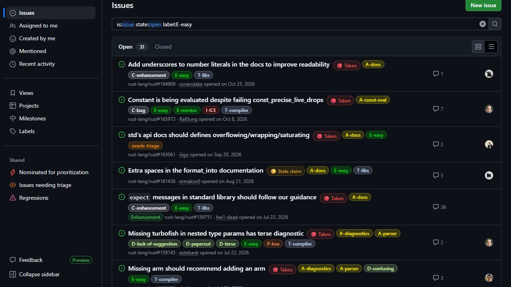
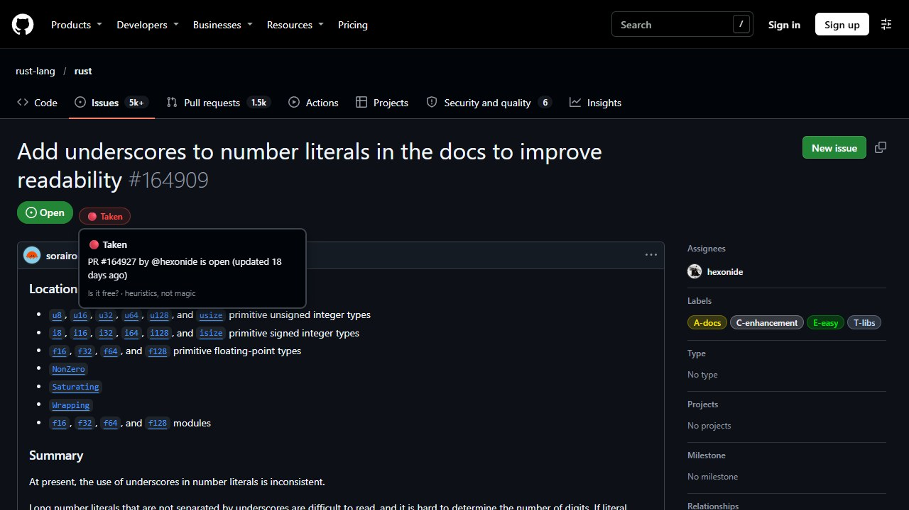
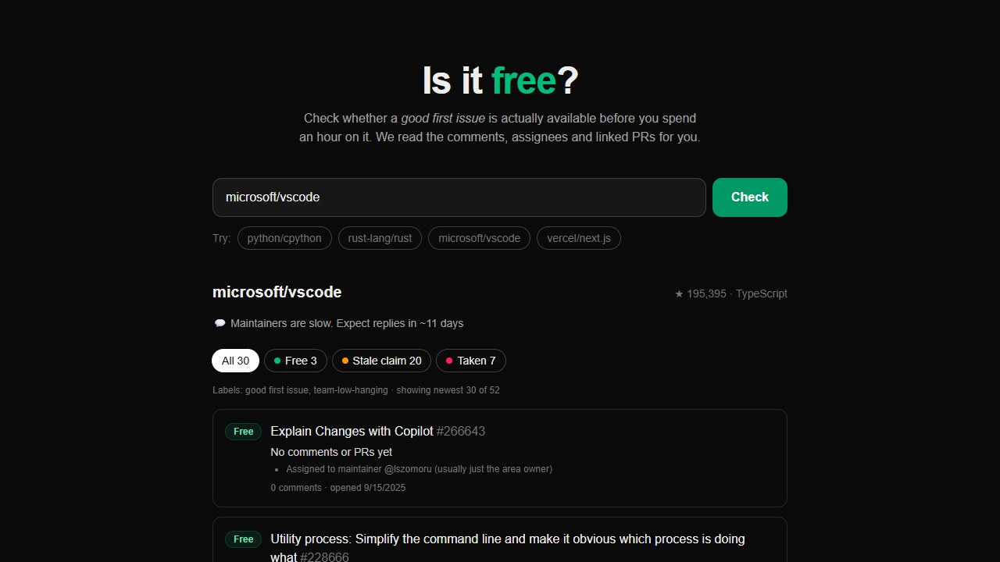

# Is it free? 🟢🟡🔴

**Check whether a "good first issue" is actually available before you spend an hour on it.**

**🔗 Live: https://is-it-free-pi.vercel.app**



New contributors find an issue labelled `good first issue`, dig into the codebase, and then find out
someone claimed it three weeks ago in a comment, or a PR is already open. *Is it free?* reads the
comments, assignees and linked pull requests for you, and gives every beginner issue a status:

| Status | Meaning |
| --- | --- |
| 🟢 **Free** | Nobody has claimed it, nobody outside the team is assigned, and there's no open PR. |
| 🟡 **Stale claim** | Someone claimed it or opened a PR, but there's been no activity for 14+ days (30+ for PRs). Politely ask to take over. |
| 🔴 **Taken** | Active PR, recent claim, outside assignee, a `(taken)` label, or a merged PR (probably already fixed). |

It also estimates **how quickly maintainers reply**, so you know whether a repo is worth your time.

## Chrome extension

The `extension/` folder has a Chrome extension that puts the badge **right on GitHub issue pages**,
next to the Open label, and on **issue list pages** next to every title. Hover over a badge to see why, and click it to open the full report.

**Install (developer mode):**
1. Download or clone this repo.
2. Open `chrome://extensions` and switch on **Developer mode** (top right).
3. Click **Load unpacked** and choose the `extension` folder.
4. Open any GitHub issue.

It uses the hosted API, so you don't need a GitHub token. Clicking the toolbar icon opens the web app
for the repo you're viewing. The extension's tests run with the rest (`npm test`) and use jsdom against GitHub's issue-page markup.

| Issue page (hover for the reason) | Web app |
| --- | --- |
|  |  |

## Usage

Paste any of these:

- `owner/repo`: scans the newest 30 open beginner issues
- `https://github.com/owner/repo`
- `https://github.com/owner/repo/issues/123`: checks a single issue

Results have shareable links: `/?q=rust-lang/rust`.

## How it works

1. **Find the beginner labels.** Repos spell them differently (`good first issue`, `E-easy`,
   `Difficulty: starter`, `first-timers-only`, `junior job`, `up-for-grabs`…), so labels are searched by
   keyword and filtered with a regex. Labels like `good first issue (taken)` are treated as a *taken* signal instead.
2. **Fetch issues, comments and timelines** using two parallel GitHub GraphQL queries. Comment *bodies*
   are fetched through parallel REST calls instead, because GraphQL is roughly 10x slower for them. They're
   only fetched for issues where someone outside the team commented.
3. **Classify** (`src/lib/classify.ts`) in priority order:
   1. an open, recently updated **same-repo PR** means taken
   2. a **merged PR** means probably fixed
   3. a **taken label** means taken
   4. a **recent claim** ("can I work on this?", "/assign", "I'd like to take this"…) or an **outside assignee** means taken
   5. an **old claim, assignee or PR** with no follow-up means stale
   6. otherwise free, with warnings for things like "open 5 years with 40 comments"
4. Maintainer comments and staff assignees (often just the area owner) don't count as claims.
   A claimant saying "I can't continue / feel free to take it" withdraws their claim.

These are heuristics, not magic. When in doubt, ask in the issue.

## Running locally

```bash
npm install
cp .env.example .env.local   # then paste a GitHub token
npm run dev                  # http://localhost:3000
npm test                     # unit tests for the classifier and parser
```

Use a **classic** token with **no scopes ticked** (it can then only read public data). Don't use a
fine-grained token: GitHub hides cross-referenced PR events from them, so linked PRs would go undetected.
If you use the GitHub CLI, you can skip the file with `GITHUB_TOKEN=$(gh auth token) npm run dev`.

## Deploying

Deploy to Vercel (or anywhere that runs Next.js) and set the `GITHUB_TOKEN` environment variable.
Results are cached in memory for 5 minutes and label lists for 24 hours to save API quota.

## Stack

Next.js 16 (App Router, Cache Components) · React 19 · TypeScript · Tailwind CSS 4 · Vitest · GitHub GraphQL + REST APIs

## Roadmap

- [ ] Search across many repos by language ("free Python issues right now")
- [x] Browser extension that shows the badge directly on GitHub issue pages
- [x] Extension: badges on issue *list* pages
- [ ] Publish the extension to the Chrome Web Store
- [ ] LLM fallback for claims the regex misses
- [ ] Open Graph images for shared links
